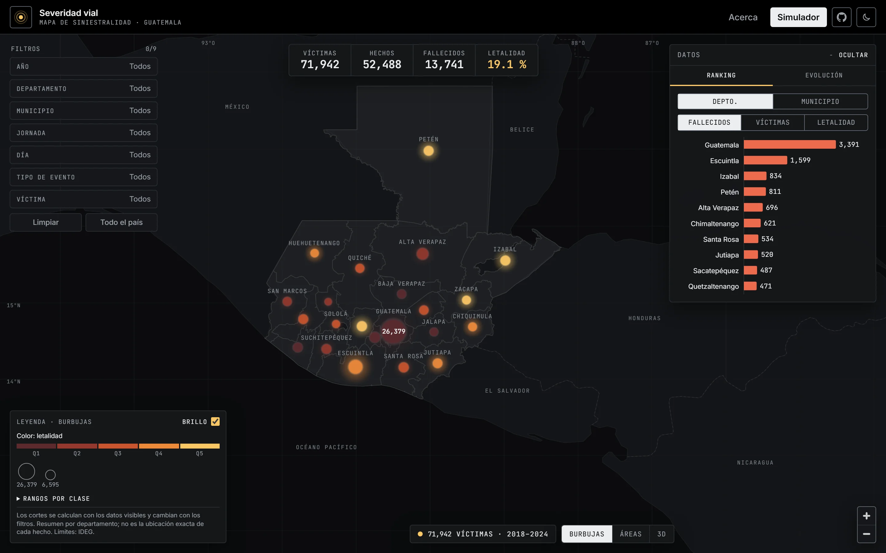
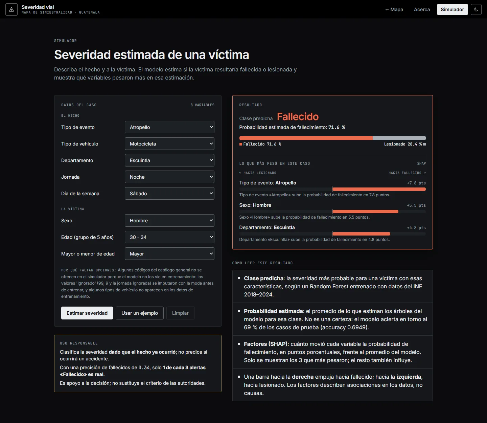
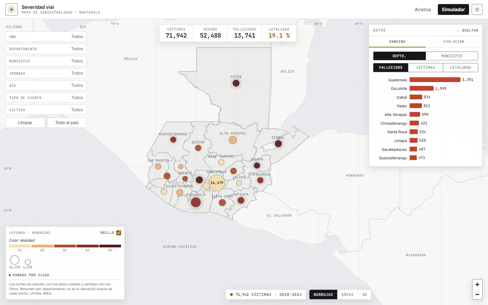
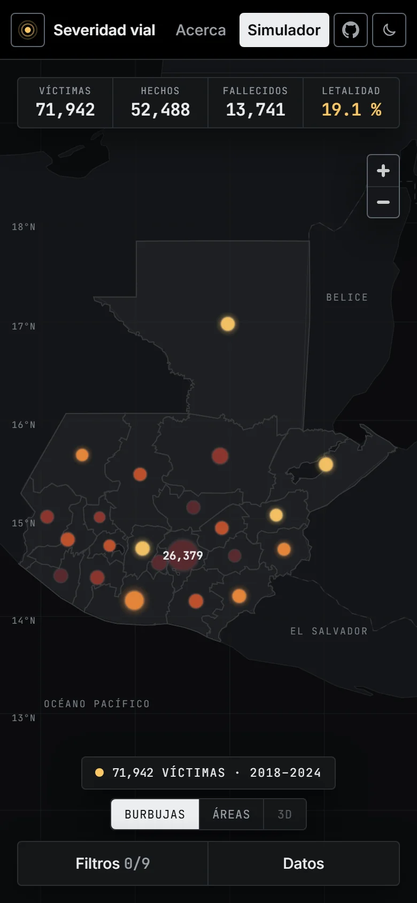
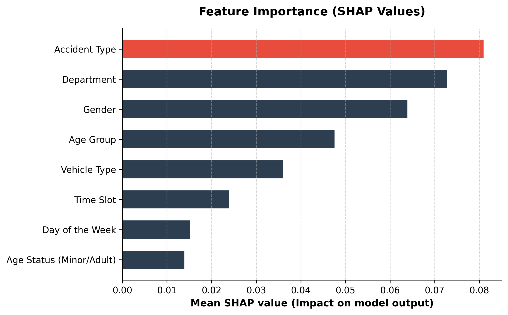
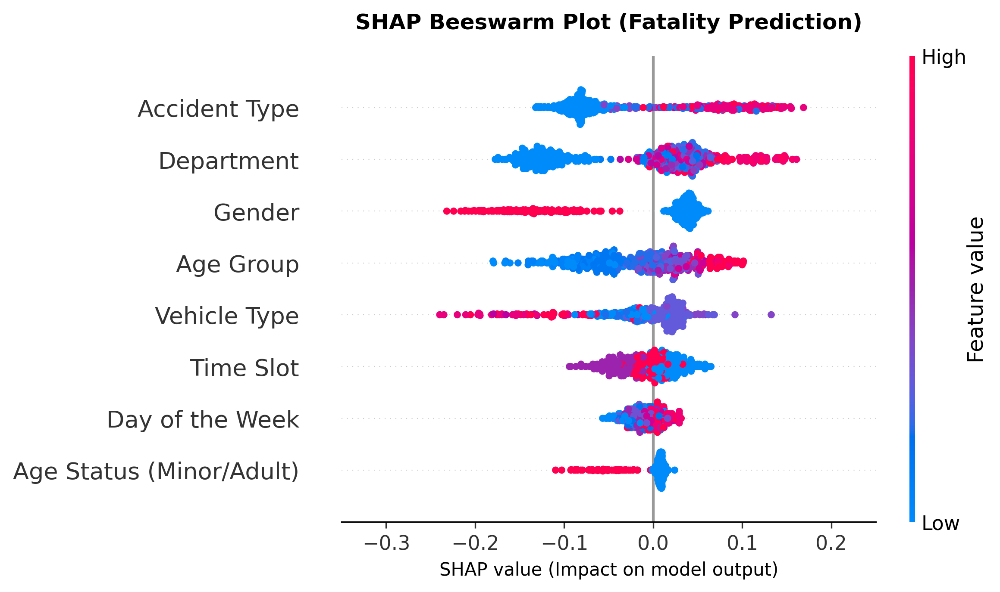
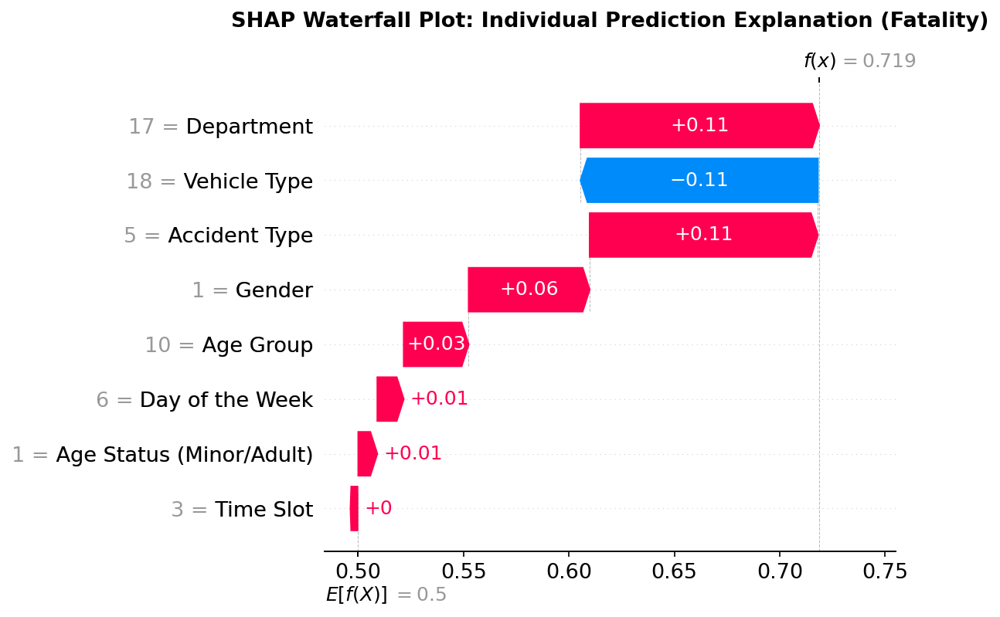
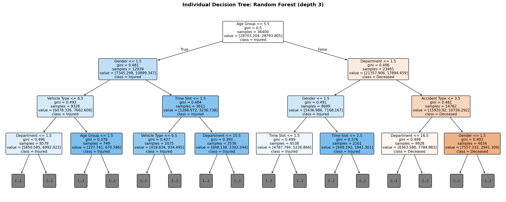

# crash-severity-predictor
Machine learning system for predicting traffic crash severity in Guatemala using INE microdata (2018-2024).

API REST (FastAPI + PostgreSQL/PostGIS) con estadísticas, mapas y un modelo
Random Forest que clasifica la severidad de una víctima (fallecido o lesionado),
y una aplicación web (React + MapLibre, en `frontend/`) con el mapa, el
simulador y la página "Acerca de".



## Instalación

Requisitos: Python 3.14, Docker (Docker Desktop en Windows) para la base de
datos, y Node.js 20, 22 o 24+ para el frontend. La base es **PostgreSQL 17 +
PostGIS 3.5 en Docker** (esquema en `db/schema.sql`), en desarrollo y en el
servidor.

```bash
python -m venv .venv
.venv\Scripts\activate            # Windows  (Linux/macOS: source .venv/bin/activate)
pip install -r requirements.txt   # producción
pip install -r requirements-dev.txt  # pruebas y notebooks
```

El modelo `data/models/random_forest.pkl` no está en git (tamaño). Se genera
con `notebooks/06_model_random_forest.ipynb`. Sin él, la API arranca igual y
`/api/predecir` responde 503.

La base necesita la semilla `db/seed/semilla.dump` (fuera de git; ver
[La semilla de la base](#la-semilla-de-la-base)).

### Variables de entorno

Se leen de `.env` en la raíz del proyecto (no se sube a git). Copie
`.env.example` y complete al menos las dos contraseñas:

```env
POSTGRES_PASSWORD=<contraseña larga, solo letras y números>
APP_DB_PASSWORD=<contraseña larga, solo letras y números>
DB_URL=postgresql+psycopg2://app_lectura:<APP_DB_PASSWORD>@127.0.0.1:5433/severidad_vial
```

| Variable | Obligatoria | Descripción |
|---|---|---|
| `POSTGRES_PASSWORD` | Sí | Superusuario `postgres` del contenedor db. |
| `APP_DB_PASSWORD` | Sí | Rol `app_lectura` (solo `SELECT`), con el que se conecta la API. |
| `DB_URL` | Para uvicorn a mano y `pytest -m integration` | Conexión de la API fuera de Docker: `app_lectura` contra la base publicada en `127.0.0.1`. `dev.ps1` la arma solo. |
| `DB_PUERTO_LOCAL` | No | Puerto de `127.0.0.1` para la base en desarrollo (por defecto `5433`). |
| `POSTGRES_DB` | No | Nombre de la base (por defecto `severidad_vial`). |
| `WEB_PORT` | No | Puerto de nginx en el despliegue (por defecto `8080`). |
| `CORS_ORIGINS` | No | Orígenes permitidos, separados por coma. Vacío = ninguno; `*` se ignora. Con el proxy de Vite no hace falta. |

### Ejecutar (desarrollo)

En Windows, desde la raíz:

```powershell
.\dev.ps1                  # base de Docker + API (uvicorn) + frontend (Vite)
.\dev.ps1 -SoloBase        # solo la base, p. ej. para las pruebas de integración
.\dev.ps1 -PuertoApi 8001  # si el puerto 8000 está ocupado
```

`dev.ps1`:

1. Comprueba que Docker esté corriendo y que `.env` tenga las contraseñas; si
   no, se detiene con un mensaje claro.
2. Levanta solo el contenedor `db` con `docker-compose.dev.yml`, que lo publica
   **solo en `127.0.0.1`** (por defecto el puerto 5433; no queda expuesto a la
   red), y espera a que esté sano con los datos cargados.
3. Abre dos ventanas: la API (`uvicorn --reload`, con el `.venv`) conectada
   como `app_lectura`, y el frontend (`npm run dev`, con el proxy de `/api`
   hacia esa API). La contraseña solo vive en esas ventanas: no se imprime.

Sin `dev.ps1` (Linux/macOS o a mano):

```bash
docker compose -f docker-compose.yml -f docker-compose.dev.yml up -d db
uvicorn core.app:app --reload        # usa la DB_URL de .env
```

Documentación interactiva: `http://localhost:8000/docs`.

`docker-compose.dev.yml` es solo para desarrollo: en el servidor la base no
debe publicar ningún puerto. Si después levanta el stack completo sin el
override (`docker compose up -d`), Compose recrea el contenedor `db` sin el
puerto; los datos están en el volumen y no se pierden.

Para publicarlo en un servidor, ver [Despliegue con Docker](#despliegue-con-docker).

### Frontend

Requisitos: Node.js 20, 22 o 24+.

```bash
cd frontend
npm install
cp .env.example .env     # VITE_API_URL=http://localhost:8000 (sin secretos)
npm run dev              # http://localhost:5173, con proxy de /api hacia la API
```

| Página | Qué muestra |
|---|---|
| `/` Mapa | Víctimas por departamento o municipio (burbujas, áreas o 3D), filtros, KPIs, ranking y evolución. |
| `/simulador` | Estima si una víctima resultaría fallecida o lesionada y explica los 3 factores que más pesaron (SHAP). |
| `/acerca` | Origen de los datos, flujo del sistema, métricas del modelo, explicabilidad (SHAP) y uso responsable. |

| Simulador | Tema claro | Móvil |
|---|---|---|
|  |  |  |

Instalación completa, variables, scripts, compilación para producción y
problemas frecuentes: [frontend/README.md](frontend/README.md).

Código: https://github.com/Sheila-Amaya/crash-severity-predictor

### Pruebas

```bash
pytest                      # todo; las de integración se omiten si no hay DB_URL
pytest -m "not integration" # solo pruebas unitarias (mocks, sin base de datos)
pytest -m integration       # contra la base de Docker (únicamente SELECT, rol app_lectura)
```

Las de integración usan la `DB_URL` de `.env` (la base local publicada en
`127.0.0.1`): levántela antes con `.\dev.ps1 -SoloBase` o con
`docker compose -f docker-compose.yml -f docker-compose.dev.yml up -d db`.

## Despliegue con Docker

Todo el sistema (base PostGIS, API y frontend con nginx) corre con un solo
comando. Pensado para publicarlo en un servidor durante meses: reinicio
automático, datos en un volumen persistente y un solo puerto expuesto.

```
                 puerto WEB_PORT (8080)
navegador ──────────────► web (nginx: SPA + proxy /api)
                              │  red "interna" (sin salida a internet)
                              ▼
                          api (FastAPI, rol app_lectura: solo SELECT)
                              │
                              ▼
                          db (PostgreSQL 17 + PostGIS 3.5, volumen pgdata)
```

### Requisitos

- Docker Engine 24+ con Docker Compose v2.24+ (o Docker Desktop).
- El modelo `data/models/random_forest.pkl` (no está en git; ver más abajo).
- La semilla de la base `db/seed/semilla.dump` (no está en git; ver más abajo).
- Unos 3 GB libres en disco y 2 GB de RAM para los contenedores.

### Pasos

```bash
cp .env.example .env            # Windows: copy .env.example .env
# Edite .env: POSTGRES_PASSWORD y APP_DB_PASSWORD (obligatorias)
# Coloque el modelo y la semilla (ver abajo) y luego:
docker compose up -d --build
```

La app queda en `http://localhost:8080` (o el `WEB_PORT` elegido). El primer
arranque restaura la semilla (alrededor de un minuto); los siguientes
reutilizan el volumen.

### Variables (`.env`)

| Variable | Obligatoria | Uso |
|---|---|---|
| `POSTGRES_PASSWORD` | Sí | Contraseña del superusuario `postgres` del contenedor db. |
| `APP_DB_PASSWORD` | Sí | Contraseña del rol `app_lectura` (solo `SELECT`), con el que se conecta la API. Solo letras y números: va dentro de una URL. |
| `POSTGRES_DB` | No | Nombre de la base (por defecto `severidad_vial`). |
| `WEB_PORT` | No | Puerto del host donde escucha nginx (por defecto `8080`). |

Si falta una obligatoria, Compose se detiene con un mensaje que la nombra.
Genere contraseñas con `openssl rand -hex 24`.

### Qué hace cada servicio

- **db** (`postgis/postgis:17-3.5`): con el volumen vacío,
  `db/docker/20_semilla.sh` verifica el SHA-256 de la semilla, la restaura,
  crea el rol `app_lectura` (solo `CONNECT` y `SELECT`, transacciones de solo
  lectura) y comprueba los conteos (71,942 víctimas, 13,741 fallecidos, 58,201
  lesionados, 52,488 hechos). Si falta la semilla o algo no cuadra, se detiene
  con un mensaje claro. No publica puertos.
- **api** (`Dockerfile`, Python 3.14.0, scikit-learn 1.8.0): usuario no root y
  `HEALTHCHECK` a `/`. No publica puertos ni tiene salida a internet.
- **web** (`frontend/Dockerfile`, nginx):
  - sirve la SPA (con `/simulador` y `/acerca` recargables) y hace proxy de
    `/api` a la API (mismo origen, sin CORS);
  - gzip y caché inmutable para `/assets/`;
  - cabeceras de seguridad: CSP con el hash del script del tema, `nosniff`,
    `Referrer-Policy` y `X-Frame-Options: DENY`. HSTS está comentado en
    `frontend/nginx.conf`: actívelo solo cuando el sitio se sirva por HTTPS.

Todos tienen `restart: unless-stopped` y límite de memoria (db 512 MB, api
1 GB, web 128 MB).

### El modelo

La API usa **`data/models/random_forest.pkl`**, montado como volumen de solo
lectura en `/app/data/models`. No va en la imagen ni en git. Si falta, la API
arranca igual, lo indica en su log y `/api/predecir` responde **503**. Durante
el build (`docker compose build api`) se comprueba que el `.pkl` y SHAP cargan
con las versiones de la imagen.

Para distribuirlo, publíquelo como asset de un GitHub Release junto con su
huella, igual que la semilla (abajo):

```bash
sha256sum data/models/random_forest.pkl > data/models/random_forest.pkl.sha256
```

### La semilla de la base

`db/seed/semilla.dump` es un `pg_dump` del esquema `public` (sin
`fallecido_lesionado_old`) de unos 5 MB. Está fuera de git (`.gitignore`).

**Generarla o actualizarla** desde la base de Docker, con el contenedor `db` en
marcha (mismo formato que restaura el contenedor en un volumen vacío):

```bash
bash scripts/docker/generar_semilla.sh            # PowerShell: .\scripts\docker\generar_semilla.ps1
bash scripts/docker/generar_semilla.sh --forzar   # reemplaza la actual y la guarda como semilla.dump.anterior
```

Crea `semilla.dump` y `semilla.dump.sha256`. Un respaldo de
`scripts/docker/respaldar.*` tiene el mismo formato: también sirve como semilla
(copiado como `db/seed/semilla.dump`, con su huella) y se carga en una base
existente con `scripts/docker/restaurar.*`.

**Publicarla** como asset de un Release (con la [CLI de GitHub](https://cli.github.com/)):

```bash
gh release create semilla-2026-10 db/seed/semilla.dump db/seed/semilla.dump.sha256 \
  --title "Semilla de la base" --notes "pg_dump del esquema public (INE 2018-2024)."
```

**Descargarla y verificarla** antes de levantar la base:

```bash
gh release download semilla-2026-10 --dir db/seed    # o descárguela desde la página del Release
cd db/seed && sha256sum -c semilla.dump.sha256       # debe decir: semilla.dump: OK
```

En PowerShell, compare `(Get-FileHash db\seed\semilla.dump -Algorithm SHA256).Hash`
con el contenido de `semilla.dump.sha256`. Si el `.sha256` está en `db/seed/`,
el contenedor también lo verifica antes de restaurar.

### Operación

```bash
docker compose ps                      # estado y salud
docker compose logs -f api             # logs de web, api o db (sin cadenas de conexión)
docker compose restart api             # reiniciar un servicio
docker compose down                    # detener (conserva los datos)
docker compose down -v                 # detener Y BORRAR la base (volumen pgdata)
```

**Actualizar** tras un `git pull`:

```bash
docker compose up -d --build           # reconstruye api y web; la base se conserva
```

La semilla solo se usa con el volumen vacío. Para cargar datos nuevos en una
base existente, use `restaurar` (abajo).

### Respaldo y restauración

```bash
bash scripts/docker/respaldar.sh                   # PowerShell: .\scripts\docker\respaldar.ps1
bash scripts/docker/probar_restauracion.sh <archivo.dump>
bash scripts/docker/restaurar.sh <archivo.dump>    # PowerShell: .\scripts\docker\restaurar.ps1 <archivo.dump>
```

- `respaldar.sh` está pensado para cron (ejemplo en
  [deploy/cron/respaldos.crontab](deploy/cron/respaldos.crontab)):
  - guarda en `respaldos/diarios/` (fuera de git) con su `.sha256`, y el
    domingo una copia en `respaldos/semanales/`;
  - conserva 7 diarios y 4 semanales (`RETENER_DIARIOS`, `RETENER_SEMANALES`);
  - comprueba que el archivo es legible y que el SHA-256 de la copia coincide
    con el del contenedor, y lo restaura en una base temporal para comparar
    los conteos (`probar_restauracion.sh`, no toca la base de la app);
  - si algo falla, no guarda el respaldo, no poda y sale con código 1.
- Los respaldos tienen el mismo formato que la semilla: uno sirve como semilla
  nueva. `respaldar.ps1` es la versión manual para Windows (un archivo en
  `respaldos/`, sin retención).
- `restaurar`:
  - verifica la huella y pide escribir `RESTAURAR` (en PowerShell, `-Confirmado`
    omite la pregunta);
  - reemplaza las tablas en una sola transacción: si algo falla, no cambia nada;
  - devuelve los permisos a `app_lectura` y muestra los conteos.
- Copie los respaldos fuera del servidor: un respaldo en el mismo disco no
  protege de la pérdida de ese disco.

### Problemas frecuentes

- **`required variable POSTGRES_PASSWORD is missing a value`**: falta la
  variable en `.env`, o se ejecutó `docker compose` fuera de la raíz del repo.
- **El contenedor db se detiene con "falta db/seed/semilla.dump"** (o con "el
  SHA-256 no coincide" o "conteos inesperados"): corrija la semilla y luego
  ejecute `docker compose down -v` y `docker compose up -d`. El `-v` es
  necesario: el volumen quedó inicializado a medias y, si no, la carga no se
  repite.
- **El simulador dice "El modelo no está disponible"**: falta
  `data/models/random_forest.pkl`; cópielo y ejecute `docker compose restart api`.
- **`Bind for 0.0.0.0:8080 failed: port is already allocated`**: otro programa
  usa el puerto; cambie `WEB_PORT` en `.env`.
- **`dev.ps1`: "Docker no está corriendo"**: abra Docker Desktop y espere a
  que diga *Engine running*.
- **`dev.ps1` o `docker compose ... up -d db`: puerto 5433 ocupado**: cambie
  `DB_PUERTO_LOCAL` en `.env` (y el puerto de `DB_URL`).
- **`pytest -m integration` falla con "connection refused"**: la base local no
  está publicada; ejecute `.\dev.ps1 -SoloBase` (o el `docker compose` con
  `docker-compose.dev.yml`) y compruebe que `DB_URL` en `.env` apunte a
  `127.0.0.1` y a ese puerto.
- **Cambié `APP_DB_PASSWORD` y la API ya no conecta**: la contraseña del rol se
  fija al crear el volumen. Cámbiela también en la base con
  `docker compose exec db psql -U postgres -d severidad_vial -c "ALTER ROLE app_lectura PASSWORD '<nueva>'"`.
- **Errores raros (`$'\r'`) al correr los `.sh` en Linux**: el archivo tiene
  saltos de línea de Windows. `.gitattributes` los fija en LF; vuelva a
  obtenerlos con `git checkout -- scripts db`.

## Datos

Fuente: microdatos del INE de hechos de tránsito 2018–2024, en tres archivos
independientes: hechos, vehículos involucrados y fallecidos y lesionados.
Cartografía: IDEG (límites departamentales y municipales).

### `num_corre` no sirve para unir archivos

Cada archivo del INE tiene su propio `num_corre`, que es el **correlativo de
fila de ese archivo** y se reinicia cada año. No identifica al hecho de
tránsito, por lo que **no se puede usar para unir víctimas o vehículos con
hechos**. Al comparar cada víctima con el hecho que tiene el mismo
`(num_corre, año)`, el municipio coincide solo en el 5.1 % de los casos, el
día en el 3.8 % y la hora en el 5.0 % (las cinco columnas a la vez: 0.07 %).

Por eso la tabla `fallecido_lesionado` guarda **los datos del evento que trae
el propio archivo de víctimas** (año, mes, día, hora, jornada, día de la
semana, municipio, departamento, tipo de evento, tipo de vehículo) y no tiene
llave foránea hacia `hecho`.

**Las estadísticas de víctimas (fallecidos, lesionados, letalidad) se calculan
siempre con las columnas de la propia víctima**, nunca a través de `hecho`.
El conteo de hechos se calcula por separado sobre la tabla `hecho`.

Carga de víctimas: `scripts/cargar_fallecido_lesionado.py`
(migración `db/migrations/001_fallecido_lesionado_con_datos_propios.sql`).
La migración ya está aplicada en la semilla de la base de Docker: no hace falta
volver a ejecutarla. La prueba en seco (`python scripts/cargar_fallecido_lesionado.py`)
funciona contra la base local con la `DB_URL` de `app_lectura`; `--ejecutar`
escribe, así que necesitaría el usuario `postgres`
(`postgresql+psycopg2://postgres:<POSTGRES_PASSWORD>@127.0.0.1:5433/severidad_vial`)
y, al terminar, `restaurar`/`generar_semilla` para conservar el resultado.
Las correcciones aplicadas a los datos de origen están en
`data/clean/correcciones_fallecido_lesionado.csv`.

| Tabla | Filas |
|---|---|
| `hecho` | 52,488 |
| `fallecido_lesionado` | 71,942 (13,741 fallecidos, 58,201 lesionados) |

## Indicadores

### Letalidad (índice de riesgo)

```
letalidad = fallecidos / (fallecidos + lesionados) * 100
```

Se calcula sobre la tabla de víctimas (`fallecido_lesionado`), con dos
decimales. Es `null` cuando no hay víctimas que cumplan los filtros.
Sin filtros: 13,741 / 71,942 * 100 = **19.1 %**.

`hechos` es un conteo aparte (tabla `hecho`) y no interviene en la letalidad.

### Filtros

Todos los endpoints de estadísticas y el mapa coroplético aceptan estos query
params opcionales. Solo se aceptan códigos que existen en los datos; un código
inexistente devuelve **422** con los valores válidos.

| Filtro | Tipo | Valores |
|---|---|---|
| `anio` | evento | 2018–2024 |
| `depto` | evento | 1–22 |
| `municipio` | evento | código DDMM de `cat_municipio` (340); debe pertenecer a `depto` si se envían ambos |
| `g_hora_5` | evento | 1 Mañana, 2 Tarde, 3 Noche, 4 Ignorada |
| `dia_sem_ocu` | evento | 1 Lunes … 7 Domingo |
| `tipo_eve` | evento | 1–8, 99 Ignorado |
| `tipo_veh` | víctima | 1–16, 18, 20, 22–24, 99 Ignorado (tipo de vehículo de la víctima) |
| `sexo` | víctima | 1 Hombre, 2 Mujer, 9 Ignorado |
| `edad_quinquenales` | víctima | 1–17, 18 Ignorado |

Las opciones con su descripción se obtienen de `GET /api/catalogos`.

**Regla de filtros de evento y de víctima:**

- Los **filtros de evento** se aplican a hechos y a víctimas por separado,
  cada uno con sus propias columnas (en `hecho`, el departamento se deriva del
  código DDMM del municipio).
- Los **filtros de víctima** (`tipo_veh`, `sexo`, `edad_quinquenales`) solo se
  aplican a víctimas. Como no hay forma de vincular víctimas con hechos, en ese
  caso **`hechos` es `null`** y la respuesta incluye un campo `nota` que lo
  explica.

## Explicabilidad del modelo

El modelo es un **Random Forest de 200 árboles** que clasifica a cada víctima
como fallecida o lesionada a partir de 8 variables del hecho y de la persona.
Se entrenó con 57,553 registros y se evaluó en 14,389 registros de prueba
(partición 80/20), con las clases equilibradas (`class_weight="balanced"`, sin
generar datos sintéticos).

**El resultado es un puntaje del modelo entre 0 y 1; no es la probabilidad
real de fallecer (en los datos, los fallecidos son el 19.1 %).** Al equilibrar
las clases, el puntaje medio del modelo es 0.5.

**Métricas del modelo — evaluación en datos de prueba**

| Métrica | Valor |
|---|---|
| Accuracy | 0.6949 |
| F1 ponderado | 0.7233 |
| ROC-AUC | 0.7336 |
| Recall de fallecidos | 0.6245 |
| Precisión de fallecidos | 0.3382 |

**Cómo leer estas figuras**

- SHAP mide cuánto movió cada variable la predicción respecto al promedio del
  modelo.
- Son asociaciones aprendidas de los datos, no causas.
- Varias variables están codificadas como números (departamento, tipo de
  evento…): «alto» o «bajo» se refiere al número del código.

Las etiquetas de las figuras están en inglés: *Accident Type* (tipo de evento),
*Department* (departamento), *Gender* (sexo), *Age Group* (grupo de edad),
*Vehicle Type* (tipo de vehículo), *Time Slot* (jornada), *Day of the Week*
(día de la semana) y *Age Status* (mayor o menor de edad). Las figuras explican
la clase fallecido.

### Qué variables pesan más



Valor SHAP absoluto medio por variable: cuánto mueve cada una la predicción,
sin importar si la empuja hacia fallecido o lesionado. El tipo de evento es la
variable que más pesa (≈0.08), seguida del departamento (≈0.07) y el sexo
(≈0.06); el día de la semana y si la víctima es mayor o menor de edad son las
que menos (≈0.015). El rojo solo resalta la primera barra.

### Cómo empuja cada variable, víctima por víctima



Cada punto es una víctima de una muestra de 500 registros de prueba. A la
derecha, esa variable empuja la predicción hacia fallecido; a la izquierda,
hacia lesionado. El color es el valor numérico del código de la variable
(azul = bajo, rojo = alto), no una intensidad: en departamento o tipo de
evento, «alto» o «bajo» solo es el número del código. Donde hay solo dos
códigos se lee directo: en sexo, los puntos rojos (2 = mujer) quedan a la
izquierda y los azules (1 = hombre) a la derecha; en mayor o menor de edad, los
rojos (2 = menor) quedan a la izquierda.

### Una predicción explicada paso a paso



Ejemplo de una sola víctima. El modelo parte de un puntaje medio de 0.5 y
llega a 0.719. En los datos, Petén y los atropellos tienen una proporción de
fallecidos mayor que el promedio, y en este caso suman +0.11 cada uno; el
vehículo bicicleta resta 0.11. Son asociaciones aprendidas de los datos, no
causas.

**Datos de este caso**

| Variable | Valor (código) | Aporte |
|---|---|---|
| Departamento | Petén (17) | +0.11 |
| Tipo de vehículo | Bicicleta (18) | −0.11 |
| Tipo de evento | Atropello (5) | +0.11 |
| Sexo | Hombre (1) | +0.06 |
| Grupo de edad | 45 - 49 (10) | +0.03 |
| Día de la semana | Sábado (6) | +0.01 |
| Mayor o menor de edad | Mayor (1) | +0.01 |
| Jornada | Noche (3) | +0.00 |

Proporción de fallecidos en los datos: Petén 34.6 %, atropellos 26.5 %,
promedio 19.1 %. La bicicleta resta en este caso aunque, en el total de datos,
su proporción (24.2 %, con solo 161 víctimas) no es menor que el promedio: SHAP
mide el aporte de cada valor dentro de esta combinación concreta, no la tasa
general de esa variable.

### Un árbol del bosque (ilustrativo)



Ilustrativo: es uno de los 200 árboles del bosque, cortado a profundidad 3
(los nodos "(...)" continúan). La predicción final promedia los 200 árboles,
así que un árbol aislado no explica el modelo.

- **Colores:** azul, predomina lesionado; naranja, predomina fallecido. Más
  intenso = más puro (una sola clase domina la caja).
- Las cifras de cada caja corresponden a una muestra de entrenamiento con
  remuestreo, no al total de datos.

## Endpoints

Todas las rutas usan el prefijo `/api`. Los ejemplos asumen `http://localhost:8000`.

### `GET /` — estado de la API

```bash
curl http://localhost:8000/
```

### `GET /api/catalogos` — opciones de los menús de filtros

Para cada filtro, la lista `{id, descripcion}` de los códigos que existen en
los datos (municipios incluyen `depto`). Los códigos ignorados se muestran
como "Ignorado".

```bash
curl http://localhost:8000/api/catalogos
```

### `GET /api/resumen` — totales

Devuelve `hechos`, `victimas`, `fallecidos`, `lesionados`, `letalidad` y `nota`.

```bash
curl "http://localhost:8000/api/resumen"
curl "http://localhost:8000/api/resumen?anio=2023&depto=1"
curl "http://localhost:8000/api/resumen?anio=2023&sexo=2"   # hechos = null
```

### `GET /api/estadisticas/serie` — serie por dimensión

`agrupar` (obligatorio): `anio`, `mes`, `dia_sem` o `jornada` (= `g_hora_5`).
Cada punto trae `clave`, `etiqueta`, `hechos`, `victimas`, `fallecidos`,
`lesionados` y `letalidad`.

```bash
curl "http://localhost:8000/api/estadisticas/serie?agrupar=anio"
curl "http://localhost:8000/api/estadisticas/serie?agrupar=mes&anio=2024&depto=5"
```

### `GET /api/estadisticas/ranking` — ranking territorial

| Parámetro | Valores | Por defecto |
|---|---|---|
| `nivel` | `depto`, `municipio` | `depto` |
| `limite` | 1–340 | 10 |
| `orden` | `fallecidos`, `victimas`, `letalidad` (descendente) | `fallecidos` |

Solo incluye lugares con víctimas que cumplan los filtros.

```bash
curl "http://localhost:8000/api/estadisticas/ranking?nivel=depto&limite=10"
curl "http://localhost:8000/api/estadisticas/ranking?nivel=municipio&limite=5&depto=1&orden=letalidad"
```

### `GET /api/mapa/coropletico` — mapa coroplético (GeoJSON)

`nivel`: `depto` (por defecto) o `municipio`. Geometría simplificada con
`ST_SimplifyPreserveTopology` (tolerancia 0.002°, 5 decimales): unos 96 KB por
departamento y 369 KB por municipio. Propiedades de cada feature: `codigo`,
`nombre`, `depto`, `hechos`, `total` (víctimas), `fallecidos`, `lesionados`,
`letalidad`. Todos los filtros afectan los conteos; `depto` y `municipio`
además limitan las geometrías devueltas. No hay coordenadas por hecho, por lo
que el mapa es solo coroplético.

```bash
curl "http://localhost:8000/api/mapa/coropletico?nivel=depto"
curl "http://localhost:8000/api/mapa/coropletico?nivel=municipio&depto=1&anio=2023"
```

### `POST /api/predecir` — severidad de una víctima

Entrada: `tipo_eve`, `tipo_veh`, `g_hora_5`, `dia_sem_ocu`, `sexo_per`,
`edad_quinquenales`, `mayor_menor`, `depto_ocu`. Solo se aceptan los códigos
que el modelo vio en entrenamiento (`data/clean/train.parquet`; ver
`/api/predecir/opciones`); los códigos
"Ignorado" (99, 9 y `g_hora_5=4`) se imputaron antes de entrenar y se
rechazan con 422.

Salida: `resultado`, `clase` (1 Fallecido, 2 Lesionado), `confianza`,
`probabilidades` y `factores`: las 3 variables con mayor contribución SHAP
local (TreeExplainer) hacia la clase predicha, en puntos sobre 100, con
`efecto` `aumenta` o `disminuye`.

`confianza` y `probabilidades` vienen de `predict_proba` y se expresan sobre
100, pero son el **puntaje del modelo**, no la probabilidad real de fallecer:
el modelo se entrenó con las clases equilibradas, así que su puntaje medio es
0.5 (50) y no el 19.1 % de fallecidos de los datos. El simulador los muestra
como "puntaje de severidad (0 a 1)". Los nombres de los campos no cambian.

```bash
curl -X POST http://localhost:8000/api/predecir \
  -H "Content-Type: application/json" \
  -d '{"tipo_eve": 2, "tipo_veh": 18, "g_hora_5": 3, "dia_sem_ocu": 6, "sexo_per": 1, "edad_quinquenales": 7, "mayor_menor": 1, "depto_ocu": 1}'
```

### `GET /api/predecir/opciones` — opciones del simulador

Para cada una de las 8 variables del modelo (`tipo_eve`, `tipo_veh`,
`g_hora_5`, `dia_sem_ocu`, `sexo_per`, `edad_quinquenales`, `mayor_menor`,
`depto_ocu`), la lista `{id, descripcion}` de los códigos que el modelo vio en
entrenamiento, más un campo `nota`. Los códigos salen de
`data/clean/train.parquet`, la misma fuente con la que `/api/predecir` valida
la entrada, así que toda opción ofrecida es aceptada por el modelo. No incluye
99, 9, `g_hora_5=4` ni `tipo_veh=15`; `edad_quinquenales=18` ("Ignorado") sí se
incluye porque se conservó como categoría en el entrenamiento. Las
descripciones salen de los catálogos de la base.

Los filtros del dashboard usan `/api/catalogos`; el simulador usa este endpoint.

```bash
curl http://localhost:8000/api/predecir/opciones
```

### `GET /api/catalogs/*` — catálogos individuales

Catálogos completos de la base: `departamentos`, `municipios/{depto_ocu}`,
`dias-semana`, `grupos-hora`, `grupos-hora-5`, `tipos-evento`,
`tipos-vehiculo`, `marcas-vehiculo`, `grupos-modelo`,
`modelos-vehiculo/{marca_veh}`, `colores-vehiculo`, `sexo`, `grupos-edad-80`,
`grupos-edad-60`, `edad-quinquenal`, `mayor-menor`, `estado-conductor`,
`internado`, `fallecido-lesionado`.

```bash
curl http://localhost:8000/api/catalogs/departamentos
curl http://localhost:8000/api/catalogs/municipios/1
```
